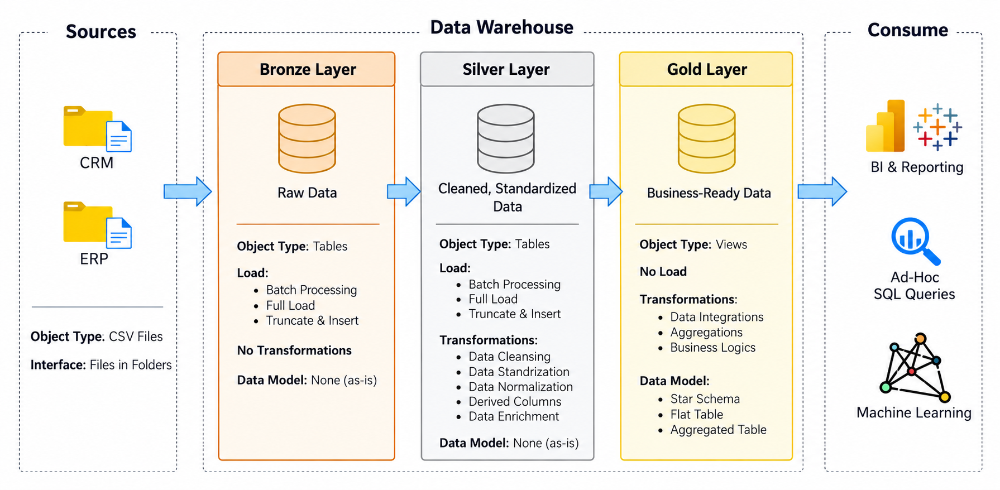
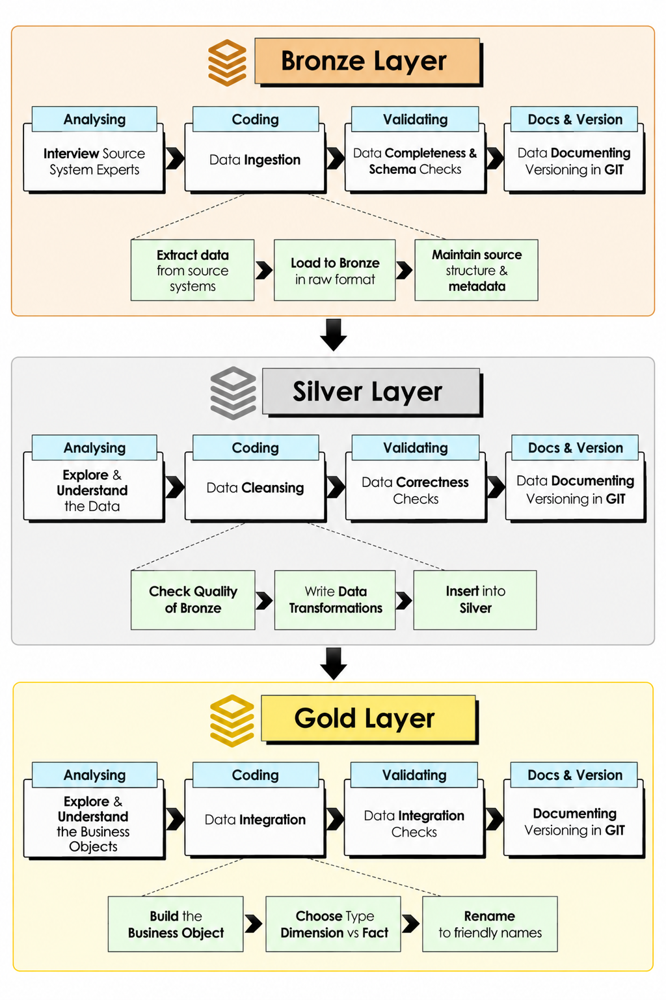
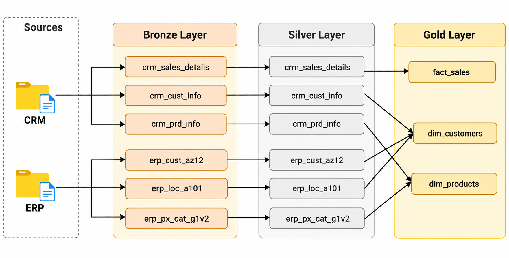
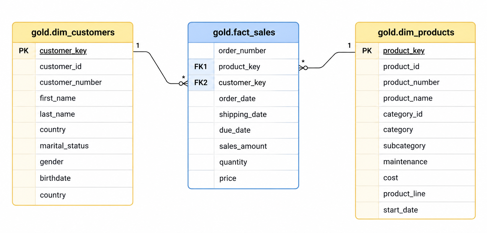

# SQL Data Warehouse Project

## 📌 Project Overview

This project demonstrates the design and implementation of a modern **Data Warehouse using DuckDB and SQL**, following the **Medallion Architecture (Bronze, Silver, and Gold layers)**.

The data warehouse integrates sales, customer, and product data from two different source systems: **CRM (Customer Relationship Management)** and **ERP (Enterprise Resource Planning)**.

The project covers the complete ETL (Extract, Transform, Load) process, including data ingestion, data cleansing, transformation, integration, data modeling, and data quality validation.

## 🎯 Project Objectives

- Build a structured data warehouse using DuckDB and SQL.
- Integrate data from multiple source systems (CRM and ERP).
- Implement the Medallion Architecture for efficient data processing.
- Clean and standardize raw data to ensure consistency and accuracy.
- Develop a Star Schema with fact and dimension views.
- Create business-ready datasets for reporting and analytics.
- Implement data quality checks throughout the ETL pipeline.
- Maintain clear documentation and version control.

## 🏗️ Data Architecture

The project follows the **Medallion Architecture**, consisting of 3 layers:
### 🥉 Bronze Layer — Raw Data

The Bronze layer stores raw data ingested from external source systems.

**Data Sources:**
- CRM: Customer information, product information, and sales transactions.
- ERP: Customer demographics, customer locations, and product categories.

**Key Processes:**
- Extract data from CSV files.
- Load data into Bronze tables using DuckDB's `COPY` statement.
- Preserve the original source data structure.
- Perform initial data completeness and schema checks.

**Loading Strategy:** Full Load (Truncate and Insert)

**Data Format:** CSV

### 🥈 Silver Layer — Cleaned Data

The Silver layer transforms raw data from the Bronze layer into clean, standardized, and consistent datasets.

**Key Transformations:**
- Remove duplicate customer records.
- Trim unnecessary whitespace.
- Standardize gender and marital status values.
- Handle missing, invalid, and NULL values.
- Convert dates into standardized formats.
- Calculate product validity periods using window functions.
- Validate and correct sales amounts and prices.
- Standardize customer identifiers across CRM and ERP systems.
- Normalize product classifications and country names.

**Loading Strategy:** Full Load

**Data Processing:** Data Cleansing, Standardization, and Transformation

### 🥇 Gold Layer — Business-Ready Data

The Gold layer integrates cleaned data from the Silver layer into business-ready datasets optimized for reporting and analytics.

The Gold layer follows a **Star Schema**, consisting of two dimension views and one fact view.

**Dimension Views:**

1. `gold.dim_customers` — Consolidated customer information.
2. `gold.dim_products` — Current product information and classifications.

**Fact View:**

3. `gold.fact_sales` — Sales transactions, quantities, prices, and revenue.

**Key Processes:**
- Integrate customer information from CRM and ERP systems.
- Combine product information with product categories.
- Generate surrogate keys for customer and product dimensions.
- Filter historical product records.
- Establish logical relationships between fact and dimension views.
- Provide structured datasets for business intelligence and analytics.

## 🔄 ETL Pipeline

The data processing workflow follows these stages:

1. Data Extraction - Raw CSV files are collected from CRM and ERP source systems.
2. Data Ingestion - Source data is loaded into Bronze tables using DuckDB's `COPY` command.
3. Data Transformation - Bronze data is cleaned, standardized, deduplicated, and transformed before being inserted into Silver tables.
4. Data Integration - Silver datasets are combined to create customer and product dimensions and a sales fact view.
5. Data Validation - Data quality checks are performed to verify completeness, consistency, accuracy, and integrity.
6. Data Consumption - Gold-layer views provide business-ready datasets for analytical queries, dashboards, and reporting.

## 🗂️ Data Sources
The project integrates six datasets from two source systems.

| Source System | Dataset | Description |
|---|---|---|
| CRM | crm_cust_info | Customer information |
| CRM | crm_prd_info | Product information and history |
| CRM | crm_sales_details | Sales transactions and orders |
| ERP | erp_CUST_AZ12 | Customer demographics |
| ERP | erp_LOC_A101 | Customer geographical information |
| ERP | erp_PX_CAT_G1V2 | Product categories and subcategories |

All source datasets are provided in CSV format.

## ⭐ Data Modeling

The Gold layer implements a **Star Schema** to organize data for analytical workloads.

### Dimension: `gold.dim_customers`

Contains customer information integrated from CRM and ERP systems.

**Key Attributes:**
- Customer Key (Surrogate Key)
- Customer ID
- Customer Number
- First Name
- Last Name
- Country
- Marital Status
- Gender
- Birthday
- Created Date

### Dimension: `gold.dim_products`

Contains current product information and classifications.

**Key Attributes:**
- Product Key (Surrogate Key)
- Product ID
- Product Number
- Product Name
- Category ID
- Category
- Subcategory
- Maintenance
- Product Cost
- Product Line
- Start Date

### Fact: `gold.fact_sales`

Contains sales transactions linked to customer and product dimensions.

**Key Attributes:**
- Order Number
- Product Key (Foreign Key)
- Customer Key (Foreign Key)
- Order Date
- Shipping Date
- Due Date
- Sales Amount
- Quantity
- Price

### Relationships

| Dimension | Fact Table | Relationship |
|---|---|---|
| dim_customers | fact_sales | One-to-Many |
| dim_products | fact_sales | One-to-Many |

These relationships are implemented through SQL joins. Primary and foreign keys are logical identifiers rather than enforced constraints on the views.

## 🛠️ Technologies Used

| Technology | Purpose |
|---|---|
| DuckDB | Analytical database management system |
| SQL | Data ingestion, transformation, and querying |
| CSV | Source data format |
| Git | Version control |
| GitHub | Source code management and project documentation |
| Star Schema | Dimensional data modeling |
| Medallion Architecture | Data warehouse architecture |

---

## 🧹 Data Quality and Transformation

Several data quality techniques are implemented throughout the project.

### 1. Duplicate Removal

Uses the `ROW_NUMBER()` window function to identify duplicate customer records and retain the most recent entry.

### 2. Data Standardization

Standardizes inconsistent categorical values.

Examples:

- `M` → `Male`
- `F` → `Female`
- `S` → `Single`
- `DE` → `GERMANY`
- `US` → `United States`

### 3. NULL Handling

Uses `COALESCE()` and conditional expressions to handle missing values.

### 4. Date Standardization

Converts integer-based dates into DuckDB's `DATE` format using `STRPTIME()`.

Example:

`20261029` → `2026-10-29`

### 5. Historical Data Management

Uses the `LEAD()` window function to calculate product validity periods.

The Gold layer retains only current product records.

### 6. Sales Data Validation

Applies business rules to identify and correct inconsistent sales amounts and prices.

### 7. Data Integration

Standardizes customer and product identifiers to enable integration between CRM and ERP datasets.

## 📊 Business Applications

The Gold layer is designed to support various business intelligence and analytical use cases such as 
- sales analaysis 
- customer analysis 
- product analysis 

## 📚 Key SQL Concepts Demonstrated

This project demonstrates practical SQL skills commonly used in data engineering:

- Data Definition Language (DDL)
- Data Manipulation Language (DML)
- CSV Data Ingestion
- Common Table Expressions (CTEs)
- Window Functions (`ROW_NUMBER`, `LEAD`)
- SQL Joins
- Conditional Logic (`CASE WHEN`)
- NULL Handling (`COALESCE`, `NULLIF`)
- String Manipulation
- Date Conversion
- Data Deduplication
- Data Transformation
- Data Integration
- Views
- Dimensional Modeling
- Data Quality Validation

## 📌 Conclusion

This project demonstrates an end-to-end SQL-based data warehouse implementation using DuckDB.

By applying the Medallion Architecture, the project transforms raw CRM and ERP datasets into clean, integrated, and business-ready information.

The implementation highlights essential data engineering practices, including data ingestion, data cleansing, transformation, dimensional modeling, and data validation.

The resulting Gold layer provides a structured foundation for business intelligence, reporting, and data-driven decision-making.