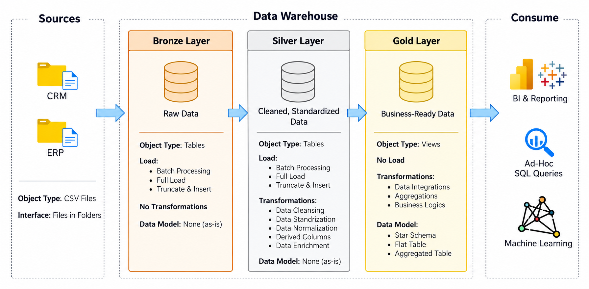
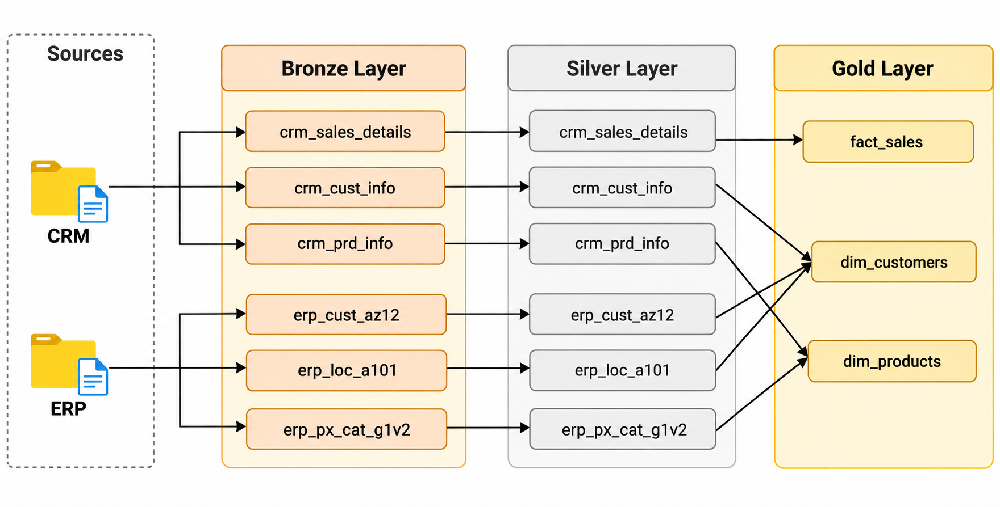
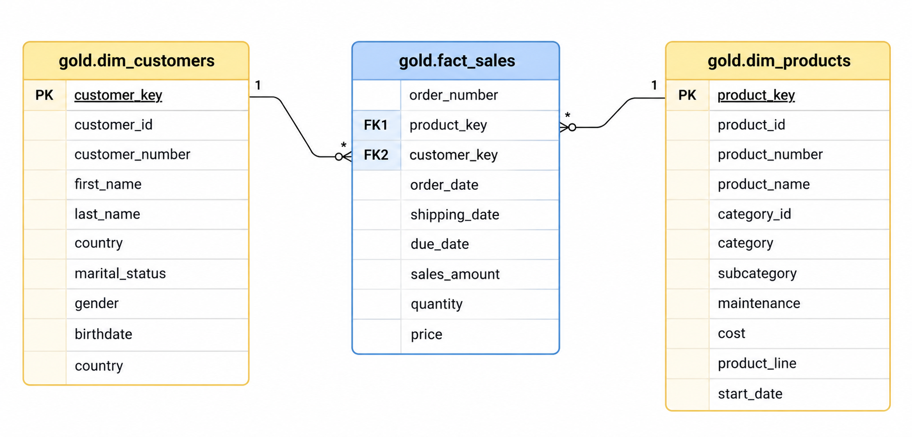

# SQL Data Warehouse Project

An end-to-end **Data Warehouse project built with DuckDB and SQL**, implementing the **Medallion Architecture (Bronze, Silver, and Gold Layers)** to transform raw CRM and ERP data from csv files into structured, business-ready datasets.

The project demonstrates essential data engineering practices, including **ETL pipelines, data cleansing, data integration, data quality validation, and dimensional modeling**.



## 🏗️ Data Architecture

The data warehouse follows a three-layer Medallion Architecture:

| Layer | Description |
|---|---|
| 🥉 **Bronze** | Ingests raw CSV data from CRM and ERP source systems. |
| 🥈 **Silver** | Cleans, standardizes, validates, and transforms raw data. |
| 🥇 **Gold** | Integrates data into a Star Schema for business intelligence and analytics. |

### Data Sources

The project integrates six datasets from two source systems:

- **CRM:** Customer information, product information, and sales transactions.
- **ERP:** Customer demographics, geographical information, and product categories.



### Gold Layer — Star Schema

The final data model consists of three analytical views:

- `gold.dim_customers` — Customer demographics and information.
- `gold.dim_products` — Product details and classifications.
- `gold.fact_sales` — Sales transactions and financial metrics.




## 📂 Repository Structure

```text
SQL_DataEngineering_Project/
│
├── 01_data_sets/
│   ├── source_crm/
│   │   ├── cust_info.csv
│   │   ├── prd_info.csv
│   │   └── sales_details.csv
│   │
│   └── source_erp/
│       ├── CUST_AZ12.csv
│       ├── LOC_A101.csv
│       └── PX_CAT_G1V2.csv
│
├── 02_scripts/
│   ├── bronze/
│   │   ├── bronze_layer_ddl.sql
│   │   └── bronze_layer_load.sql
│   │
│   ├── silver/
│   │   ├── silver_layer_ddl.sql
│   │   └── silver_layer_load.sql
│   │
│   └── gold/
│       └── gold_layer_ddl.sql
│
├── docs/
│   └── data_catalog.md
│   └── project_documentation.md
│
├── README.md
└── .gitignore
```
## 🛠️ Tech Stack

| Technology | Usage |
|---|---|
| DuckDB | Analytical database |
| SQL | Data processing and transformation |
| CSV | Source datasets |
| Git & GitHub | Version control and documentation |
| Medallion Architecture | Data warehouse architecture |
| Star Schema | Dimensional data modeling |

## 📖 Project Documentation

For detailed information about the architecture, ETL pipeline, data transformations, data model, and implementation, see:

**[Full Project Documentation](./docs/project_documentation.md)**

## 🎯 Project Highlights

- End-to-end ETL pipeline using SQL.
- Integration of CRM and ERP datasets.
- Data cleansing and standardization.
- Data quality validation.
- Star Schema implementation.
- Business-ready analytical views.

## 📌 Project Purpose

This project was developed to demonstrate practical **SQL and Data Engineering skills**, focusing on building a structured, maintainable data warehouse that supports business intelligence and data-driven decision-making.